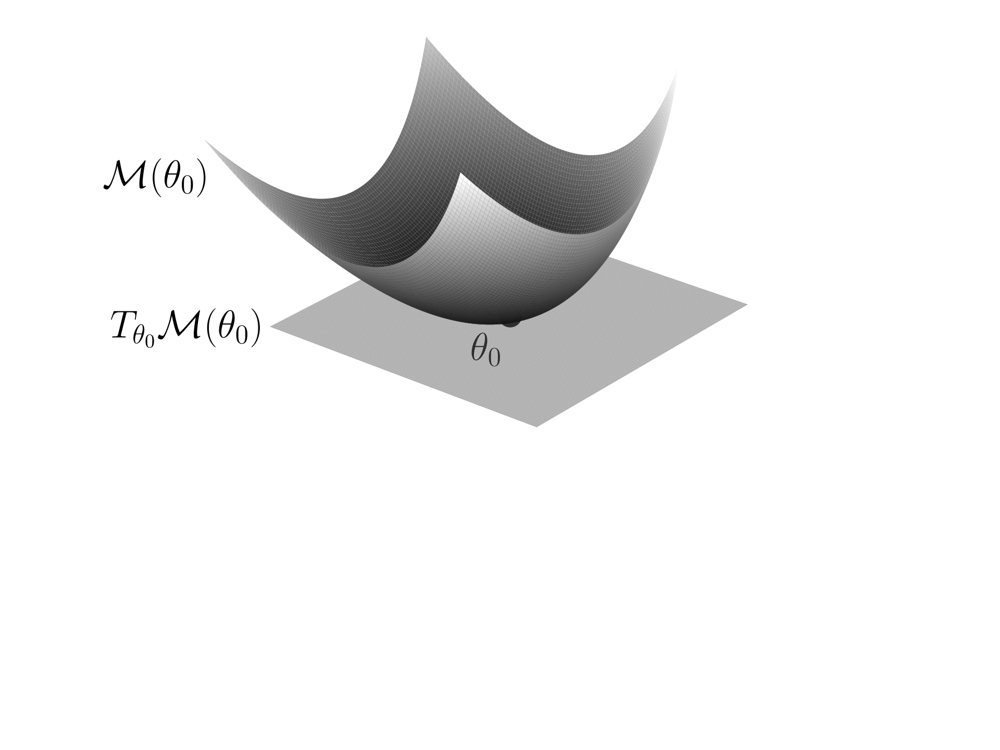
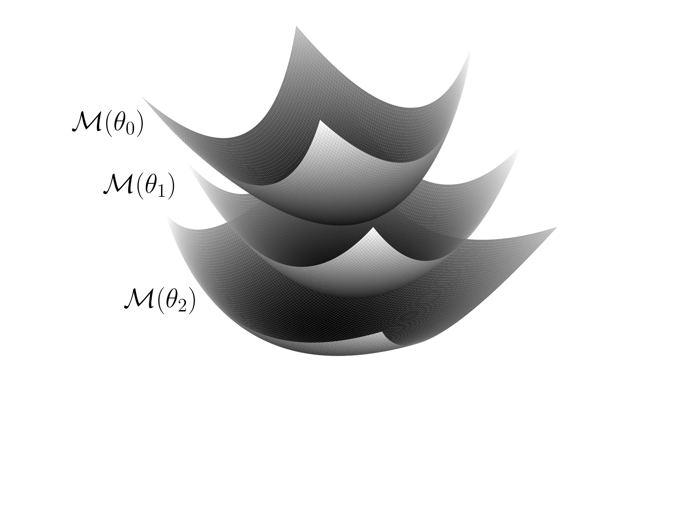

(cha:laplace:diffgeo)=
# The differential geometric perspective on Laplace

+++
Linearised Laplace approximations ([Section {name}](#sec:laplace:linearization)), and specifically their covariance structure, have interpretations in Riemannian and information geometry. They encode the neural network’s parameter space geometry, as informed by the loss.

(sec:laplace:ggn-metric)=
## The GGN Metric

+++
In the previous chapter, we discussed in detail the curvature matrix defined in Equation [](#eq:laplace:ggn), called the Generalised Gauss-Newton matrix (GGN). It is the precision term from the likelihood and, combined with the precision term from the prior and inverting, it yields the covariance matrix of a linearised Laplace approximation.

Recall that the GGN matrix at the parameters {math}`\theta\in\mathbb{R}^{P}` is given by (Equation [](#eq:laplace:ggnformula))

```{math}
G(\theta) = \nabla_\theta \nabla_\theta^{\top} \mathcal{L}^{\theta}(\theta) = \sum_{n = 1}^{N} \left(\jaclogit(x_n, \theta)\right)^{\top} \left(\nabla_{z}\nabla_{z}^{\top} \ell(z, y_n)\big|_{z = f(x_n, \theta)}\right) \jaclogit(x_n, \theta).
```

We will now see how the GGN arises as a metric on the parameter space. Recall our training data {math}`\mathcal{D}=\{(x_n,y_n)\}_{n=1,\dots,N}`. We restrict the neural network {math}`f\colon \mathbb{R}^D\times\mathbb{R}^P \to \mathbb{R}^C` to the training set, to obtain the function

```{math}
:label: eq:laplace:restricted_network

\begin{aligned}
    f_X\colon \mathbb{R}^P &\to \left(\mathbb{R}^C\right)^N \\
\theta &\mapsto (f(x_n, \theta))_{n=1}^N.
\end{aligned}
```

For a single input-label pair {math}`(x_n, y_n)`, assuming {math}`\ell(z,y_n)` is strictly convex (which is the case, for example, for the squared loss in regression), the positive definite loss Hessian

```{math}
H_n(z):=\nabla_{z}\nabla_{z}^{\top} \ell(z, y_n)
```

characterises a **Riemannian metric** in the output space {math}`\mathbb{R}^{C}`. That is, it defines a symmetric positive definite bilinear form {math}`(v_1,v_2)\mapsto v_1^\top H_n(z)v_2` at each point {math}`z\in \mathbb{R}^{C}`. Such a metric encodes the *curvature* of the loss given the target {math}`y_n`. Note that if the likelihood is an exponential family, then {math}`H_n` is independent of the target {math}`y_n` ([](#pro:laplace:ef)).

In fact, we only require {math}`\ell(z,y_n)` to be (not necessarily strictly) convex, in which case {math}`H_n` is only positive semidefinite. This is the case for the cross-entropy loss in classification, where the Hessian is rank-deficient. In this case, {math}`H_n` defines a *degenerate* Riemannian metric on {math}`\mathbb{R}^{C}`.

We can then equip the image of {math}`f_X`, {math}`(\mathbb{R}^C)^N`, with the block diagonal (degenerate) Riemannian metric

```{math}
H(z) =
    \begin{bmatrix}
    H_1(z_1) & 0 & \cdots & 0 \\
    0 & H_2(z_2) &  & \vdots \\
    \vdots &  & \ddots & 0 \\
    0 & \cdots & 0 & H_N(z_N)
    \end{bmatrix}
```

in standard coordinates, where {math}`z = (z_1,\dots , z_N)`. This metric characterises the curvature of the loss on the training set. It can then be pulled back through {math}`f_X` to the parameter space:

```{math}
\begin{aligned}
    (f_X^*H)(\theta) &= J_\theta f_X(\theta)^{\top} H(f_X(\theta)) J_\theta f_X(\theta) \\
    &= \sum_{n=1}^N \jaclogit(x_n, \theta)^{\top} H_n(f(x_n,\theta))\jaclogit(x_n, \theta) \\
    &= \sum_{n = 1}^{N} \left(\jaclogit(x_n, \theta)\right)^{\top} \left(\nabla_{z}\nabla_{z}^{\top} \ell(z, y_n)\big|_{z = f(x_n, \theta)}\right) \jaclogit(x_n, \theta) = G(\theta),
\end{aligned}
```

i.e., the **pullback** {math}`f_X^*H` corresponds exactly to the GGN {math}`G`.

Due to symmetries in the neural network architecture (see [](#part:identifiability_and_symmetries)) and overparametrisation, the GGN is rank-deficient and only positive *semi*definite. It therefore defines again a *degenerate* Riemannian metric on the parameter space.[^footnote-1] Thus, *damping* is needed to get a proper Riemannian metric on the parameter space. The strictly convex regulariser term {math}`\Omega(\theta)` is such a dampener: adding its Hessian to the GGN results in a positive definite matrix (cf. Equation [](#eq:laplace:damped))

```{math}
\nabla_\theta \nabla_\theta^{\top} \regrisk^{\theta}(\theta) = \nabla_\theta \nabla_\theta^{\top} \mathcal{L}^{\theta}(\theta) + \nabla_\theta\nabla_\theta^{\top} \Omega(\theta).
```

Using this as a preconditioner in second-order optimisation means we perform Riemannian (stochastic) gradient descent in the parameter space.

:::{figure}
:label: fig:laplace:mfds
:class: grid grid-cols-2 items-end gap-4





*Left:* A fiber manifold $\mathcal M(\theta_0)$ in the parameter space, and its tangent space $T_{\theta_0}\mathcal M(\theta_0)$ at $\theta_0$. The fiber manifold consists of the parameters yielding the same output values on the training data as $\theta_0$ (Equation [](#eq:laplace:fibers)), the tangent space consists of the kernel directions of the GGN at $\theta_0$. *Right:* A collection of three fibers in parameter space. The parameter space is partitioned into a disjoint union of such fibers.
:::

+++
But how do we interpret the GGN metric? We base our presentation on {cite:t}`roy2024reparameterization`. Fixing a parameter vector {math}`\theta_0`, consider the set

```{math}
:label: eq:laplace:fibers

\mathcal M(\theta_0) = \{\theta\in\mathbb{R}^P: f_X(\theta) = f_X(\theta_0)\}
```

i.e., the set of parameters {math}`\theta` for which the neural network defines the same function on the training data as {math}`\theta_0`. This is an equivalence class of parameters, called a **fiber**. By the preimage theorem {cite:p}`tu2011introduction{Theorem 9.9}`, it is (locally) a manifold of dimension {math}`P-N C` if {math}`f_X` is (locally) continuously differentiable and the Jacobians {math}`J_\theta f_X(\theta)` are surjective for all (local) {math}`\theta\in \mathcal M(\theta_0)`. Intuitively, the parameter space is {math}`P`-dimensional but we constrain the model’s prediction on the training set of {math}`N` samples, meaning we put {math}`N C` scalar constraints on the output. This eliminates {math}`N C` degrees of freedom, yielding a {math}`(P - N C)`-dimensional manifold. The surjectivity condition holds in particular when the eigenvalues of the neural tangent kernel matrix over the entire training set are bounded away from 0, a common assumption for overparametrised models, see @roy2024reparameterization [Appendix A] and the references therein.

Further, when the Jacobians {math}`J_\theta f_X(\theta)` are surjective locally around {math}`\theta_0`, the preimage theorem further tells us that {math}`\ker J_{\theta}f_X(\theta_0) = T_{\theta_0}\mathcal M(\theta_0)`, the tangent space of {math}`\mathcal M(\theta_0)` at {math}`\theta_0` (see [](#fig:laplace:mfds)). If the Hessians {math}`\nabla_{z}\nabla_{z}^{\top} \ell(z, y_n)` are full rank (for example, when {math}`\ell(z,y_n) = \|z-y_n\|^2` the squared loss), we get {math}`\ker G(\theta_0) = T_{\theta_0}\mathcal M(\theta_0)`. These are directions in which the training data gives us no information about the parameters. Thus, in such directions, linearised Laplace approximations solely rely on the prior. The orthogonal complement of this null space consists of the directions in which the training data gives us information.

Now having defined the fibers in parameter space, we can quotient them out to obtain the **effective parameter space**: {math}`\mathbb{R}^P/\sim` where {math}`\sim` is the equivalence relation induced by {math}`f_X`, {math}`\theta_0 \sim \theta_1 \Leftrightarrow f_X(\theta_0) = f_X(\theta_1)`. The effective parameters are parameters for which the neural network {math}`f` takes *distinct* values on the training data. Formally, the effective parameter space is a *fiber bundle* over the parameter space. It can be thought of as a manifold perpendicular to the fibers {math}`\mathcal M(\theta)`; {cite:t}`roy2024reparameterization` construct such a manifold explicitly. We note, however, that this is an arbitrary choice, as there is no canonical way to choose representatives for the equivalence classes and hence such a manifold. As a consequence, the non-linear effective parameter space is difficult to leverage computationally. However, the GGN’s degenerate metric on the original parameter space {math}`\mathbb{R}^P` captures the similarity of training outputs between different parameters. One therefore does not have to construct the effective parameter space explicitly, but rather use the GGN’s geometry in the parameter space.

:::{admonition} Takeaways

+++
The GGN is the **pullback** through the restricted network {math}`f_X` of the loss-curvature metric on the training outputs,

```{math}
G(\theta) = (f_X^*H)(\theta) = J_\theta f_X(\theta)^{\top}\, H(f_X(\theta))\, J_\theta f_X(\theta),
```

and therefore defines a (degenerate) Riemannian metric on the parameter space {math}`\mathbb{R}^P`. Its null space coincides with the tangent space {math}`T_{\theta_0}\mathcal M(\theta_0)` of the *fiber* {math}`\mathcal M(\theta_0)` of parameters producing identical outputs on the training data: these are the directions in which the data is uninformative and a linearised Laplace approximation falls back on the prior. Damping (e.g. a strictly convex regulariser {math}`\Omega`) turns this degenerate metric into a proper one.
:::

(sec:laplace:fisher-metric)=
## The Fisher Metric

+++
In the previous chapter we saw that the GGN metric can be seen as the pullback of the loss curvature metric on the training outputs. We now ask whether there is a more intrinsic, parametrisation-independent justification for this metric. We offer a such a perspective on the GGN metric via information geometry.

Recall from Chapter [](#cha:laplace:linearized), Equation [](#eq:laplace:fisher) the **Fisher information metric**

```{math}
:label: eq:laplace:fisher-metric

\begin{aligned}
        F(\theta) &= \mathbb{E}_{p(x, y \mid \theta)}\left[-\nabla_{\theta}\nabla_{\theta}^{\top} \log p(x, y \mid \theta)\right] \\
        &= \mathbb{E}_{p(x, y \mid \theta)}\left[\nabla_{\theta} \log p(x, y \mid \theta)(\nabla_{\theta} \log p(x, y \mid \theta))^{\top}\right]
    \end{aligned}
```

which we now view as a degenerate Riemannian metric on the parameter space {math}`\mathbb{R}^P`. If we take the empirical distribution on the {math}`x`, {math}`\frac{1}{N}\sum_{n=1}^N \delta_{x_n}`, we get (Equations [](#eq:laplace:fisher-approx) and [](#eq:laplace:fisher-approx2))

```{math}
:label: eq:laplace:fisher-metric-approx

\begin{aligned}
        \tilde{F}(\theta) &= \frac{1}{N} \sum_{n=1}^{N} \mathbb{E}_{p(y \mid x, \theta)}\left[-\nabla_{\theta}\nabla_{\theta}^{\top} \log p(y \mid x, \theta)\right] \\
        &= \frac{1}{N} \sum_{n=1}^{N} \nabla_{\theta}\log p(y_n \mid x_n, \theta) \left(\nabla_{\theta} \log p(y_n \mid x_n, \theta)\right)^{\top}.
    \end{aligned}
```

We saw in Chapter [](#cha:laplace:linearized) that {math}`\tilde{F}(\theta) = \frac{1}{N}G(\theta)`, a renormalisation of the GGN metric, under the mild condition that the Hessian of the negative log-likelihood loss does not depend on the target {math}`y` (see Equation [](#eq:laplace:equalities)).

This gives an important connection between the covariance used in linearised approximation and the fundamental object from information geometry, which is the Fisher information metric. The goal of this chapter is to explain the importance of the Fisher information metric, why it can be seen as the natural metric for any probabilistic model, and its interpretation in deep learning.

A **statistical manifold** is a manifold {math}`\mathcal M` consisting of probability measures. Any parametric statistical model defines a parametrisation of a statistical manifold {math}`\mathbb{R}^P \to \mathcal M`. What is {math}`\mathcal M` for a neural network? So far, we have viewed a neural network as a map {math}`f\colon \mathbb{R}^D\times \mathbb{R}^P \to \mathbb{R}^C`. However, recall that we assume it induces probability distributions {math}`p(y\mid x,\theta)`, since the loss function {math}`\ell(f(x,\theta), y)` is assumed to be the negative log-likelihood {math}`-\log p(y \mid x,\theta)`. Therefore we implicitly viewed {math}`f` as a probabilistic model; for each {math}`x\in \mathbb{R}^D`, and {math}`\theta\in \mathbb{R}^P`, we have a probability measure {math}`\mathrm f(x,\theta) \in \mathcal P(\mathcal{Y})` defined by the neural network, where {math}`\mathcal{Y}` is the set of labels ({math}`\mathbb{R}^C` for regression, {math}`\{1,\dots,C\}` for classification) and {math}`\mathcal P(\mathcal{Y})` is the space of probability measures on the set of labels. {math}`\mathrm f` is given by the composition of {math}`f` with some appropriate {math}`\mathrm g\colon \mathbb{R}^C \to \mathcal P(\mathcal{Y})`. In regression, we most often take {math}`\mathrm g(z) = \mathcal N(z, \epsilon^2 I) \in \mathcal P(\mathbb{R}^C)` for some fixed {math}`\epsilon>0`, while in classification, most often {math}`\mathrm g(z) = \operatorname{softmax}(z) \in \Delta^{C-1} \cong \mathcal P(\{1,\dots,C\})`. In Chapter [](#cha:laplace:linearized), we saw that both of these choices guarantee the equivalence between the Fisher and the GGN (Equation [](#eq:laplace:equalities)).

So we have a map {math}`\mathrm f\colon \mathbb{R}^D\times \mathbb{R}^P \to \mathcal P(\mathcal{Y})`. Write {math}`p(y\mid x,\theta)` for the density of {math}`\mathrm f(x,\theta)`, so {math}`p(y\mid x,\theta) = \frac{1}{\sqrt{2\pi}\epsilon}\exp\left(-\frac{1}{2\epsilon^2}\|f(x,\theta)-y\|^2\right)` in regression, {math}`p(y\mid x,\theta) = \operatorname{softmax}(f(x,\theta))_y` in classification. Then the **statistical model** {math}`\mathrm m\colon \mathbb{R}^P \to \mathcal P(\mathbb{R}^D\times \mathcal{Y})` is defined as the joint distribution over {math}`x` and {math}`y`. Namely, if the distribution over the inputs {math}`x` has a density {math}`p(x)`, the density of {math}`\mathrm m(\theta)` is {math}`p(x,y\mid \theta) := p(x)p(y\mid x,\theta)`. As discussed above, in practice we take the empirical distribution over {math}`x`. The statistical manifold {math}`\mathcal M` defined by the neural network {math}`f` is the image of {math}`\mathrm m` in {math}`\mathcal P(\mathbb{R}^D\times \mathcal{Y})`.

This is where the Fisher information metric comes into play. The Fisher metric is an object *intrinsic* to the statistical manifold {math}`\mathcal M`, and is independent of how the manifold is parametrised by {math}`\mathbb{R}^P`. Formally, suppose we have a different parametrisation {math}`\tilde {\mathrm m}\colon \mathbb{R}^P \to \mathcal M`. Then {math}`\mathrm m` and {math}`\tilde {\mathrm m}` differ by some diffeomorphism[^footnote-2] of the parameter space, i.e. there is a diffeomorphism {math}`\varphi\colon \mathbb{R}^P\to \mathbb{R}^P` such that {math}`\mathrm m = \tilde {\mathrm m}\circ \varphi`. Then we see that for {math}`\tilde \theta = \varphi(\theta)`, {math}`\mathrm m(\theta) = \tilde {\mathrm m}(\tilde \theta)` or, abusing notation, {math}`p(x,y\mid \theta) = p(x,y\mid \tilde \theta)`. Therefore, from the definition of the Fisher information metric (Equation [](#eq:laplace:fisher-metric) or Equation [](#eq:laplace:fisher-metric-approx)), the Fisher information metric on the two distinct parametrisations coincide {math}`F_{\mathrm m}(\theta) = F_{\tilde{\mathrm m}}(\tilde \theta)`.

The fact that the Fisher metric does not depend on the parametrisation implies that it is intrinsic to {math}`\mathcal M`. Therefore, there should exist a way to define it directly on {math}`\mathcal M` in an abstract, measure-theoretic way. Doing this rigorously requires some mathematical groundwork, which the keen reader can find in {cite:t}`ay2017information`. Briefly, for {math}`\mu\in \mathcal M` and tangent vectors {math}`\nu_1,\nu_2\in T_\mu\mathcal M`, which are signed measures integrating to 0, the intrinsic Fisher information metric is defined by

```{math}
:label: eq:laplace:fisher-information-metric

F(\mu)[\nu_1,\nu_2] = \int \frac{\,\mathrm{d}\nu_1}{\,\mathrm{d}\mu}\frac{\,\mathrm{d}\nu_2}{\,\mathrm{d}\mu}\,\mathrm{d}\mu
```

where {math}`\frac{\,\mathrm{d}\nu_i}{\,\mathrm{d}\mu}` is the Radon-Nikodym derivative of {math}`\nu_i` with respect to {math}`\mu`, i.e. the densities of {math}`\nu_i` with respect to {math}`\mu`. Then the degenerate metric on the parameter space {math}`\mathbb{R}^P` is given by the pullback of this intrinsic metric onto {math}`\mathbb{R}^P` (see {cite:t}`ay2017information`).

There is an infinite number of ways to define an intrinsic Riemannian metric on {math}`\mathcal M`. So what makes the Fisher information metric special? It is not special for its invariance under transformations of the *parameter space*, but instead for its invariance under transformations of the *data space*.

:::{prf:definition}

+++
Let {math}`\mathcal D` be a measurable space, thought of as a data space. A *statistic* is a measurable map {math}`T\colon \mathcal D \to \mathcal D'`, where {math}`\mathcal D'` is some other measurable space.

Let {math}`\mathcal M` be a statistical manifold over {math}`\mathcal D`, that is, consisting of probability measures over {math}`\mathcal D`. A statistic {math}`T\colon \mathcal D\to \mathcal D'` is called *sufficient* if the measures in {math}`\mathcal M` have densities {math}`q(T(x),\theta)h(x)` with respect to some base measure, for {math}`x\in\mathcal D` and {math}`\theta` parametrising {math}`\mathcal M`.
:::

+++
The factorisation condition means that the likelihood depends on {math}`\theta` only through {math}`T(x)`, since the factor {math}`h(x)` has no {math}`\theta`-dependence. Thus, all information about {math}`\theta` contained in the full data point {math}`x` is also contained in the statistic {math}`T(x)`, justifying the term ‘sufficient’.

In our deep learning setting above, the data space is {math}`\mathcal D = \mathbb{R}^D\times\mathcal Y`, the product of the input space with the label space.

Note that, for a statistical manifold {math}`\mathcal M` over {math}`\mathcal D`, a statistic {math}`T\colon \mathcal D \to \mathcal D'` induces a map {math}`T_*\colon \mathcal M \to \mathcal M'` acting by pushforwards: {math}`T_*\mu = \mu\circ T^{-1}`. So {math}`\mathcal M'` is a statistical manifold over {math}`\mathcal D'`. Then, under mild assumptions on {math}`\mathcal M`, we obtain the following theorem:

:::{prf:theorem} Proposition 5.6 in @ay2017information

+++
Suppose {math}`\mathcal M` has a positive regular density function {cite:p}`ay2017information{Definition 3.5}`. Then the Fisher information metric is invariant under sufficient statistics {math}`T\colon \mathcal D\to \mathcal D'`, i.e. {math}`T_*\colon \mathcal M \to \mathcal M'` is an isometry of Riemannian manifolds, when {math}`\mathcal M` and {math}`\mathcal M'` are equipped with their respective Fisher information metrics.
:::

+++
Up to a multiplicative constant, the Fisher information metric is the unique metric satisfying this. This is Chentsov’s theorem. We leave as an exercise to verify this theorem for the special case of the deep learning setting above.

As explained above, sufficient statistics should be thought of as maps of the data space which do not induce a loss of information on the parameters with respect toa given statistical model. The Fisher information metric, being invariant under such transformations, should be thought of as quantifying ‘information’, hence its name. Note in particular that it is invariant under diffeomorphisms of the data space (which are trivially sufficient statistics owing to their bijective nature), and so does not depend on how the data is ‘presented’. This makes it the natural metric for statistical manifold {math}`\mathcal M`.

:::{admonition} Takeaways

+++
Up to the rescaling {math}`\tilde F(\theta) = \frac{1}{N} G(\theta)`, the GGN *is* the empirical Fisher information metric — the intrinsic metric on the statistical manifold {math}`\mathcal M` of distributions defined by the network. Being intrinsic, it is **independent of how {math}`\mathcal M` is parametrised**, and by *Chentsov’s theorem* it is the unique metric (up to scale) invariant under sufficient statistics, i.e. under transformations of the *data* space that lose no information about the parameters. This singles out the Fisher as the natural, ‘information-theoretic’ metric underlying the GGN.
:::

(sec:laplace:geometric-la)=
## Geometric Laplace Approximations

+++
Laplace approximations, being Gaussian approximations to the neural network’s posterior, are limited in their expressivity. As a consequence, there have been attempts at leveraging the geometry of the parameter space to define more expressive variants of Laplace approximations.

A key observation is that the Laplace approximations are not diffeomorphism-invariant: given a diffeomorphism of the parameter space {math}`\varphi\colon \mathbb{R}^P\to \mathbb{R}^P`, if such diffeomorphism is non-linear, then performing Laplace with respect to the parameters {math}`\varphi`, i.e., a **reparametrised Laplace approximation**, yields a distinct posterior approximation than performing Laplace with respect to the parameters {math}`\theta`. In the extreme case, one can show there exists a diffeomorphism {math}`\varphi` for which the Laplace approximation with respect to the corresponding parameters is exact {cite:p}`da_costa2025geometric`. In practice, computing such {math}`\varphi` is as difficult as computing the exact posterior itself. However, this result gives hope that one may be able to construct computationally feasible diffeomorphisms {math}`\varphi` yielding high-quality Laplace approximations, see for instance {cite:t}`mackay1998choice`. An important note is that, while Laplace approximations are not invariant under diffeomorphisms of the parameter space, the predictives of linearised Laplace approximations are, up to changing the prior. We leave this as an exercise to the reader.

Another attempt at leveraging geometry for Laplace is to perform the Laplace approximation in the tangent space of the parameter space and then project it through an exponential map under some Riemannian metric {cite:p}`bergamin2023riemannian,yu2024riemannian`, coined **Riemannian Laplace approximations**. The latter work uses the Fisher as the Riemannian metric. Work remains to be done to make the computation of the exponential map efficient and scalable. See {cite:t}`da_costa2025geometric` for the relationship between such Riemannian Laplace approximations and the aforementioned reparametrised Laplace approximations.

Finally, **diffusion Laplace approximations** {cite:p}`roy2024reparameterization` sample the approximate posterior through random walks with respect to a Riemannian metric in the weight space. Once again, while there are promising preliminary results, further work is needed to scale such approaches computationally. Moreover, the relationship between diffusion Laplace approximations and Riemannian Laplace approximations is yet to be described.

:::{admonition} Takeaways

+++
Laplace approximations are **not invariant** under non-linear reparametrisations {math}`\varphi\colon \mathbb{R}^P\to\mathbb{R}^P` of the parameter space — in the extreme, some {math}`\varphi` even makes Laplace exact. This freedom motivates *geometric* variants: **reparametrised**, **Riemannian** (Laplace in the tangent space pushed through an exponential map, often under the Fisher metric), and **diffusion** Laplace approximations. All exploit the parameter-space geometry for more expressive posteriors, but scalable computation — of suitable diffeomorphisms, exponential maps, and random walks — remains an open problem.
:::

[^footnote-1]: Not to be confused with pseudo-Riemannian metrics.

[^footnote-2]: A diffeomorphism is a smooth bijection with smooth inverse.
