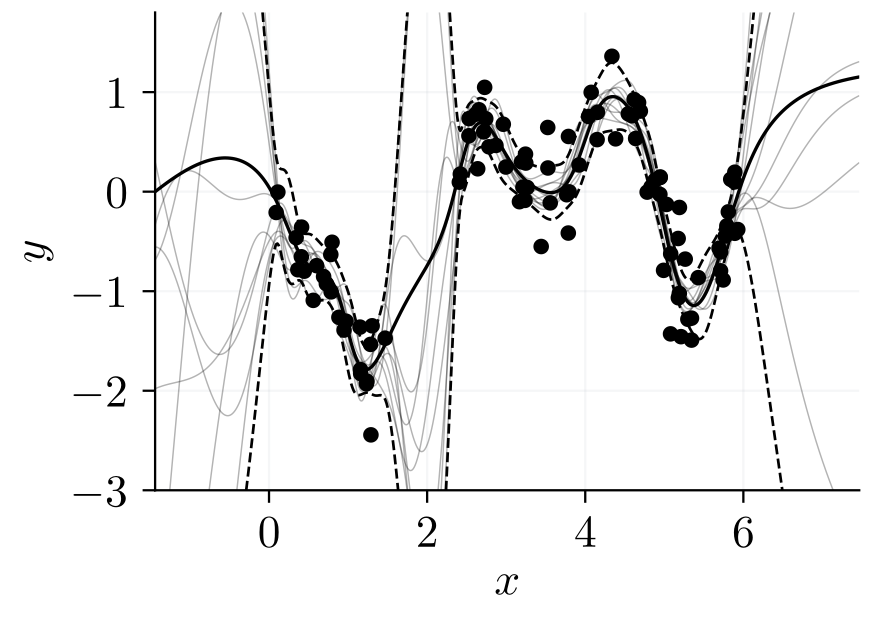
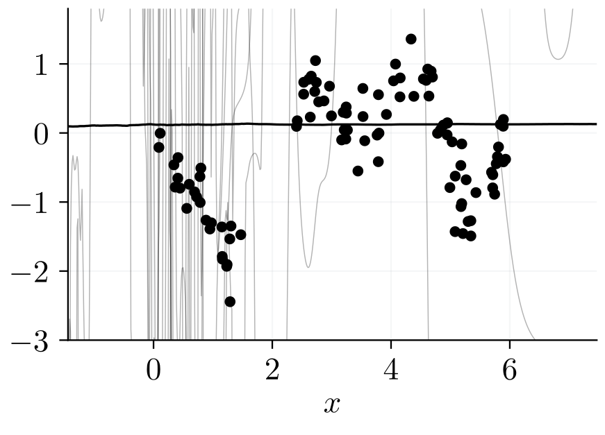
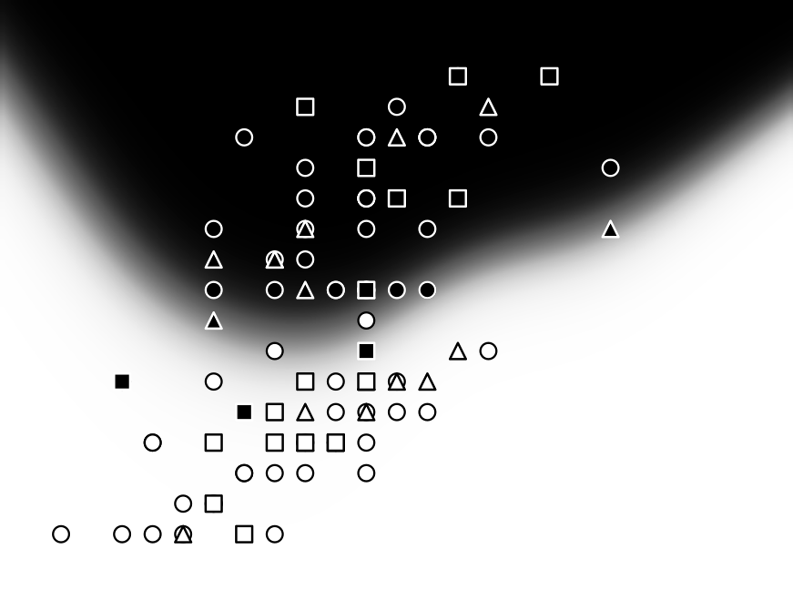
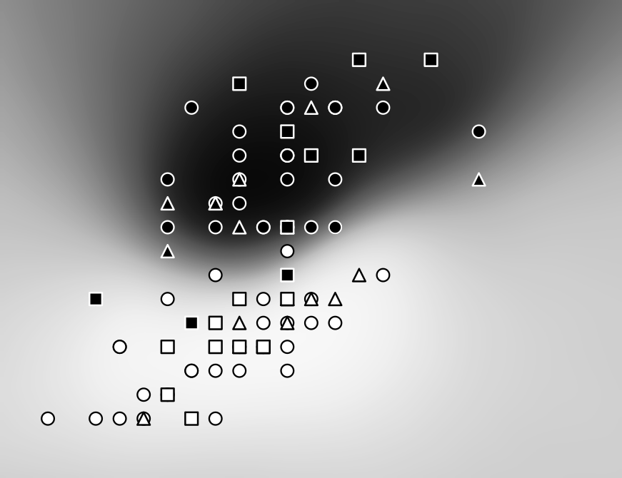
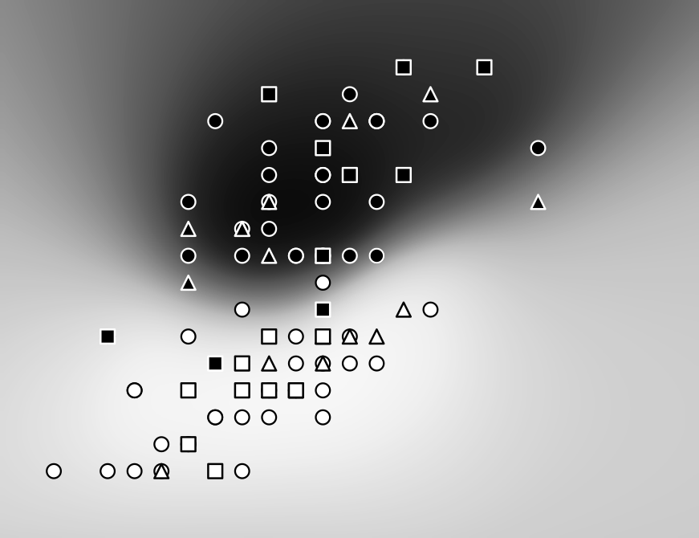
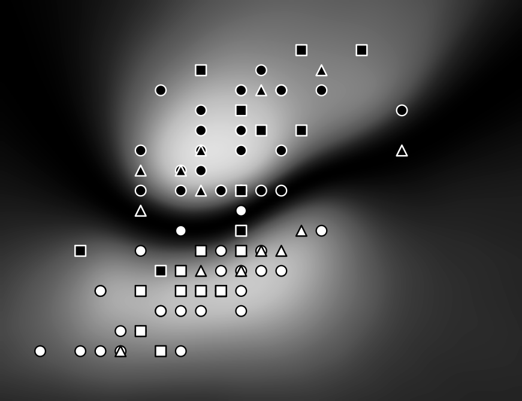

(cha:laplace:linearized)=
# Linearised Laplace approximations

+++
The previous chapter showed a computationally lightweight Gaussian approximation {math}`\mathcal{N}(\theta;\theta_*, \precision(\theta_*)^{-1})` to the true posterior {math}`p(\theta \mid \mathcal{D})` on the parameter space {math}`\mathbb{R}^{P}`. Our final goal is to use this Gaussian measure to *make decisions* based on the model’s output: its predictions feed into the risks and utilities that downstream tasks optimise (Chapter [](#cha:laplace:analytic_functionality)). To this end, we first quantify the **predictive uncertainty** of our network on the output space {math}`\mathbb{R}^{C}` by turning it into a Gaussian process (GP). [](#fig:laplace:linearized-workflow) previews the pipeline, from the maximum a posteriori (MAP) estimate {math}`\theta_*` to the predictive distribution.

:::{figure} assets/laplace_linearized/linearized_workflow-standalone.png
:label: fig:laplace:linearized-workflow
:align: center

The linearised Laplace pipeline. The linearised network $f^{\theta_*}$ and parameter covariance $\Sigma=\precision(\theta_*)^{-1}$ jointly determine the logit Gaussian process, which induces a predictive distribution.
:::

(sec:laplace:linearization)=
## Linearisation

+++
To turn an arbitrary (differentiable) neural network parameterised by {math}`\theta \in \mathbb{R}^P` into a Gaussian process, we use two ingredients: linearisation in the parameter space and the previously introduced Laplace approximation.

We first introduce the concept of the **linearised network** {math}`f^{\theta_0}\colon \mathbb{R}^{D} \times \mathbb{R}^{P} \to \mathbb{R}^{C}` as the first-order Taylor approximation of network {math}`f` around parameters {math}`\theta_0 \in \mathbb{R}^{P}`:

```{math}
:label: eq:laplace:linearized-model

f^{\theta_0}(x, \theta) := f(x, \theta_0) + \jaclogit(x, \theta_0)(\theta - \theta_0),
```

where {math}`\jaclogit(x, \theta_0) \in \mathbb{R}^{C \times P}` is the **network Jacobian** evaluated at {math}`(x, \theta_0)`.[^footnote-1] Analogously to Equation [](#eq:laplace:regularized-empirical-risk), we define the regularised empirical risk of the linearised network {math}`f^{\theta_0}` with parameters {math}`\theta` as

```{math}
:label: eq:laplace:linregrisk

\regrisk^{\theta_0}(\theta) := \sum_{n=1}^N \ell\left(f^{\theta_0}(x_n,\theta),y_n\right) + \Omega(\theta).
```

Unless explicitly stated otherwise (e.g., in the prior-only discussion in [Section {name}](#sec:laplace:prior)), we fix the linearisation point at a minimiser of the *original* regularised empirical risk {math}`\regrisk(\theta)`:

```{math}
:label: eq:laplace:minimizer

\theta_* :\in \operatorname*{arg\,min}_{\theta\in\mathbb{R}^{P}} \regrisk(\theta),
```

that is, we set {math}`\theta_0 \equiv \theta_*`. Linearisation itself only requires differentiability of {math}`f` at {math}`\theta_0`. The Laplace approximation needs more: {math}`\theta_*` must be a local minimiser of {math}`\regrisk` with zero gradient, and the resulting precision must be positive definite after adding the prior curvature. We note that {math}`f^{\theta_*}` shares its value and its parameter Jacobian with {math}`f` at {math}`\theta_*`, so {math}`\nabla_\theta \regrisk^{\theta_*}(\theta_*)=\nabla_\theta \regrisk(\theta_*)=0` and {math}`\theta_*` is a stationary point of {math}`\regrisk^{\theta_*}`, too. Because {math}`f^{\theta_*}` is affine in {math}`\theta`, convexity of {math}`\ell(\cdot,y)` in {math}`z` makes each loss term convex in {math}`\theta`; with a strictly convex {math}`\Omega`, the risk {math}`\regrisk^{\theta_*}` is then strictly convex in {math}`\theta`, hence {math}`\theta_*` is its unique minimiser.

Following [Section {name}](#sec:laplace:textbook-derivation), the Laplace approximation using the regularised empirical risk of the linearised network yields the parameter-space Gaussian measure {math}`\mathcal{N}(\theta; \theta_*, \precision(\theta_*)^{-1})` with

```{math}
:label: eq:laplace:ggn

[\precision(\theta)]_{ij} = \left[\nabla_\theta \nabla_\theta^{\top} \regrisk^{\theta_*}(\theta)\right]_{ij} = \frac{\partial^2 \regrisk^{\theta_*}(\theta)}{\partial \theta_i \partial \theta_j}.
```

The curvature {math}`\precision` of the linearised network’s regularised empirical risk differs from the Hessian in Equation [](#eq:laplace:hessian) for networks that are not piecewise affine in their parameters (except at the non-generic parameter values where all training residuals vanish). The difference is that {math}`\precision(\theta_*)`, as defined in Equation [](#eq:laplace:ggn), discards the network’s parameter curvature (and higher-order derivatives) and only retains the curvature of the *loss function* over the model outputs. The advantages of this modelling choice are summarised in [Section {name}](#subsec:laplace:advantages-of-linearized).

An important property of Gaussian measures is their closure under affine transformations, stated formally below.

:::{prf:proposition} Affine Closure of Gaussians

+++
Let {math}`X\sim\mathcal{N}(\mu,\Sigma)` with {math}`\mu\in\mathbb{R}^{N}` and {math}`\Sigma\succ0`. For any {math}`A\in\mathbb{R}^{M\times N}` with full row rank and {math}`b\in\mathbb{R}^{M}`,

```{math}
Y:=AX+b\ \sim\ \mathcal{N}\left(A\mu+b,\ A\Sigma A^{\top}\right).
```

If {math}`\operatorname{rank}(A) < M`, then {math}`A\Sigma A^{\top}\succeq0` and {math}`Y` has no Lebesgue density on {math}`\mathbb{R}^{M}`.
:::

:::{prf:proof}
:enumerated: false

+++
We first treat an invertible {math}`A\in\mathbb{R}^{N\times N}`. For any Borel set {math}`E\subseteq\mathbb{R}^{N}`, the event {math}`\{Y\in E\}` equals {math}`\{X\in A^{-1}(E-b)\}`, so substituting {math}`x=A^{-1}(y-b)`, whose Jacobian has absolute determinant {math}`|\det A^{-1}|`, gives

```{math}
p_Y(y)=p_X\left(A^{-1}(y-b)\right)|\det A^{-1}|.
```

Writing {math}`d:=y-(A\mu+b)`, we have {math}`A^{-1}(y-b)-\mu=A^{-1}d`, so

```{math}
\left(A^{-1}(y-b)-\mu\right)^{\top}\Sigma^{-1}\left(A^{-1}(y-b)-\mu\right)=d^{\top}(A\Sigma A^{\top})^{-1}d,
```

and {math}`|\Sigma|^{-1/2}|\det A^{-1}|=|A\Sigma A^{\top}|^{-1/2}` by {math}`|A\Sigma A^{\top}|=|A|^2|\Sigma|`. Substituting the Gaussian density of {math}`X` yields

```{math}
p_Y(y)=(2\pi)^{-N/2}|A\Sigma A^{\top}|^{-1/2}\exp\left(-\frac{1}{2}d^{\top}(A\Sigma A^{\top})^{-1}d\right),
```

so {math}`Y\sim\mathcal{N}(A\mu+b, A\Sigma A^{\top})`.

For the full row rank case {math}`A\in\mathbb{R}^{M\times N}` with {math}`M\le N`, choose {math}`K\in\mathbb{R}^{(N-M)\times N}` so that {math}`T:=\begin{bmatrix}A\\ K\end{bmatrix}\in\mathbb{R}^{N\times N}` is invertible, and set {math}`Y:=AX+b`, {math}`Z:=KX`, and {math}`U:=\begin{bmatrix}Y\\ Z\end{bmatrix}=TX+\begin{bmatrix}b\\ 0\end{bmatrix}`. By the invertible case, {math}`U` is Gaussian with mean {math}`\begin{bmatrix}A\mu+b\\ K\mu\end{bmatrix}` and covariance

```{math}
S:=T\Sigma T^{\top}=\begin{bmatrix}S_{11}&S_{12}\\ S_{21}&S_{22}\end{bmatrix}=\begin{bmatrix}A\Sigma A^{\top} & A\Sigma K^{\top}\\ K\Sigma A^{\top} & K\Sigma K^{\top}\end{bmatrix},\qquad S_{11}=A\Sigma A^{\top}\succ0.
```

Let {math}`C:=S_{22}-S_{21}S_{11}^{-1}S_{12}` be the (positive definite) Schur complement and {math}`B:=S_{21}S_{11}^{-1}`. With {math}`\Delta y:=y-(A\mu+b)` and {math}`\Delta z:=z-K\mu`, the block-inverse identity splits the quadratic form as

```{math}
\begin{bmatrix}\Delta y\\ \Delta z\end{bmatrix}^{\top} S^{-1}\begin{bmatrix}\Delta y\\ \Delta z\end{bmatrix}=\Delta y^{\top} S_{11}^{-1}\Delta y+(\Delta z-B\Delta y)^{\top} C^{-1}(\Delta z-B\Delta y),
```

and {math}`|S|=|S_{11}||C|`. Marginalising {math}`U` over {math}`z` with

```{math}
\int_{\mathbb{R}^{N-M}}\exp\left(-\frac{1}{2}(\Delta z-B\Delta y)^{\top} C^{-1}(\Delta z-B\Delta y)\right)\,\mathrm{d} z=(2\pi)^{(N-M)/2}|C|^{1/2}
```

leaves

```{math}
p_Y(y)=(2\pi)^{-M/2}|S_{11}|^{-1/2}\exp\left(-\frac{1}{2}\Delta y^{\top} S_{11}^{-1}\Delta y\right),
```

that is, {math}`Y\sim\mathcal{N}(A\mu+b, A\Sigma A^{\top})`. Only {math}`S_{11}=A\Sigma A^{\top}` survives, so the result is independent of the choice of {math}`K`.

Finally, if {math}`\operatorname{rank}(A)<M`, then {math}`\operatorname{rank}(A\Sigma A^{\top})=\operatorname{rank}(A)<M` because {math}`\Sigma\succ0`, so {math}`A\Sigma A^{\top}` is singular and {math}`Y` is supported on the proper affine subspace {math}`A\mathbb{R}^{N}+b`, hence has no Lebesgue density on {math}`\mathbb{R}^{M}`.
:::

+++
As such, the linearised network {math}`f^{\theta_*}` pushes the parameter posterior forward, via the affine map of Equation [](#eq:laplace:linearized-model), to a Gaussian in the output space (the logit space in classification). In the network-output variable {math}`z\in\mathbb{R}^{C}` (the logits, which the loss {math}`\ell(z,y)` takes as its first argument), this measure is

```{math}
:label: eq:laplace:output-gaussian

\mathcal{N}\left(z; f(x_*, \theta_*), \jaclogit(x_*, \theta_*) \precision(\theta_*)^{-1} \jaclogit(x_*, \theta_*)^{\top}\right).
```

This result already equips the network {math}`f` with a probability measure in its output space (or logit space in classification) for every input {math}`x_*`. A **Gaussian process** is an even more powerful construction, capable of modelling a Gaussian measure over any *finite set of inputs*, not just a single one. The linearised network {math}`f^{\theta_*}` equipped with its parameter-space Laplace approximation defines a Gaussian process {math}`\GP(f(\cdot, \theta_*), k)` with the following (Mercer) kernel:

```{math}
:label: eq:laplace:gp-kernel

\begin{align}
  k(x, x') &= \operatorname{cov}\left(f^{\theta_*}(x, \theta), f^{\theta_*}(x', \theta)\right) \\
  &= \operatorname{cov}\left(\jaclogit(x, \theta_*) (\theta - \theta_*), \jaclogit(x', \theta_*) (\theta - \theta_*)\right) \\
  &= \jaclogit(x, \theta_*) \precision(\theta_*)^{-1} \jaclogit(x', \theta_*)^{\top}.
\end{align}
```

(subsec:laplace:advantages-of-linearized)=
### Advantages of Using the Linearised Network

+++
We perform the Laplace approximation w.r.t. {math}`\regrisk^{\theta_*}` (with {math}`\theta_* = \operatorname*{arg\,min}_{\theta\in\mathbb{R}^{P}} \regrisk(\theta)`) instead of the regularised empirical risk of {math}`f` for multiple reasons.

First, the Hessian of the regularised empirical risk of {math}`f` (Equation [](#eq:laplace:hessian)) is not guaranteed to be positive definite, preventing us from interpreting it as the inverse covariance matrix of our approximate Gaussian posterior over the parameters {math}`\theta`.[^footnote-2] In second-order optimisation, the lack of positive definiteness also prohibits using the inverse Hessian as a preconditioner. However, the Hessian of the regularised empirical risk of {math}`f^{\theta_*}`, with a strongly convex regulariser, is *guaranteed* to be positive definite.

Second, the Hessian of the regularised empirical risk of {math}`f^{\theta_*}` is considerably cheaper to use than that of {math}`f`, allowing Laplace approximations to scale to deep learning architectures (see [Section {name}](#sec:laplace:fisher)).

There are thus two uses of the linearised model. First, it defines the curvature {math}`\precision` and hence the parameter-space Gaussian posterior approximation. Second, it defines the predictive pushforward in Equation [](#eq:laplace:output-gaussian). Earlier work on Laplace approximations for neural networks {cite:p}`mackay1992practical,ritter2018scalable` *sampled* {math}`M` parameter configurations {math}`\{\theta_s\}_{s=1}^{M}` from the parameter-space Gaussian and calculated *predictive* quantities from the nonlinear predictions {math}`\{f(x, \theta_s)\}_{s=1}^{M}`. This loses the exact output-space Gaussian distribution available from linearisation and yields no posterior GP. {cite:t}`lawrence2000variational` shows empirically that this approach is prone to underfitting: the predictive becomes *too uncertain* even on in-distribution data points. {cite:t}`immer2021improving` identify the core reason for performance loss as a mismatch between the model in which we perform approximate Bayesian inference (the linearised network {math}`f^{\theta_*}`) and the model we use for prediction (the nonlinear network {math}`f`). [](#fig:laplace:nonlinear-sampling-mismatch) visualises this underfitting and the low-density samples drawn under the true posterior. See also @immer2021improving [Fig. 3]. By using the linearised network to make predictions and not only to calculate the curvature, the approximation remains internally consistent.

:::{figure}
:label: fig:laplace:nonlinear-sampling-mismatch
:class: grid grid-cols-2 items-end gap-4

(fig:laplace:nonlinear-sampling-mismatch-gp)=


(fig:laplace:nonlinear-sampling-mismatch-bnn)=


The same full Laplace posterior under two predictive rules on a one-dimensional regression example from the code accompanying @immer2021improving. Both panels use the same parameter-space approximate posterior and the same ten parameter draws. They differ only in how each parameter draw becomes a function-space sample called a *sample path* in the GP literature. Panel (a) sends each draw through the linearised network $f^{\theta_*}$, the model consistent with the parameter-space Laplace approximation. Panel (b) sends the draws through the original nonlinear network $f$. Solid curves are predictive means; dashed curves show pointwise $95\%$ credible intervals. The linearised Laplace approximation in Panel (a) yields a GP; therefore, the output-space quantities are available in closed form. The (nonlinear) Laplace approximation in Panel (b) yields an intractable output mean and covariance, which we approximate with two million Monte Carlo samples. The nonlinear scheme is far more uncertain over the training inputs and its mean severely underfits. The linearised Laplace approximation yields consistent function-space uncertainty.
:::

:::{admonition} Takeaways

+++
The linearised Laplace approximation turns any differentiable neural network into a *Gaussian process* by (i) linearising the network in parameter space at {math}`\theta_*` and (ii) placing a Gaussian posterior {math}`\mathcal{N}(\theta_* , \precision(\theta_*)^{-1})` on parameters. The induced Mercer kernel has the form

```{math}
k(x,x') = \jaclogit(x,\theta_*)\precision(\theta_*)^{-1}\jaclogit(x',\theta_*)^{\top},
```

whereby {math}`\precision` captures the effect of the dataset on the *parameter-space curvature*, which the Jacobian {math}`\jaclogit(\cdot, \theta_*)` pushes forward into *function-space uncertainty*.
:::

(sec:laplace:prior)=
## The Prior

+++
The Gaussian process determined by the *posterior* parameter-space covariance matrix {math}`\precision^{-1}` is tied to the dataset {math}`\mathcal{D}`, as {math}`\precision` is the Hessian of the linearised model’s regularised empirical risk over {math}`\mathcal{D}`. It is worth spending some time on the case when the neural network {math}`f\colon \mathbb{R}^{D}\times\mathbb{R}^{P}\to\mathbb{R}^{C}` has not been exposed to any dataset {math}`\mathcal{D}` yet. In this case, the model’s behaviour is determined by its architecture and by the prior {math}`p(\theta)` over the parameters.

For a non-Gaussian parameter prior {math}`p(\theta)`, a Laplace approximation to the prior is centred at a local maximum {math}`\theta_0` of {math}`p(\theta)`, analogously to Equation [](#eq:laplace:gauss-posterior). Its precision is the negative log-prior Hessian,

```{math}
\precision = -\nabla_\theta \nabla_\theta \log p(\theta_0).
```

For the construction that follows, we specialise to a Gaussian prior centred at the linearisation point,

```{math}
p(\theta) = \mathcal{N}(\theta; \theta_0, I),
```

where {math}`\theta_0` can be any chosen initialisation. The prior’s mode is {math}`\theta_0`, so the linearisation and the Laplace approximation of the prior share the same centre, and the precision above evaluates to {math}`\precision = I`. Pushing this prior through the linearised network gives the kernel {math}`k\colon \mathbb{R}^{D} \times \mathbb{R}^{D} \to \mathbb{R}^{C \times C}`,

```{math}
k(x, x') = \jaclogit(x, \theta_0) \left(\jaclogit(x', \theta_0)\right)^{\top}.
```

The kernel comes from the same pushforward as the posterior GP kernel in Equation [](#eq:laplace:gp-kernel). Compared with it, the data-dependent pair {math}`(\theta_*,\precision(\theta_*))` is replaced by the dataset-independent pair {math}`(\theta_0,I)`. This kernel is known as the **Neural Tangent Kernel (NTK)** {cite:p}`jacot2018neural`.[^footnote-3] It differs from the neural network Gaussian process (NNGP) kernel: the NNGP kernel is the covariance of random network outputs {math}`f(x,\theta)` and {math}`f(x',\theta)` under a random initialisation distribution, while the NTK is the covariance of the linearised network outputs {math}`f^{\theta_0}(x,\theta)` and {math}`f^{\theta_0}(x',\theta)` under the prior {math}`\mathcal{N}(\theta;\theta_0,I)`. As the network width is taken to infinity in a specific way, both kernels are convergent. Where these limits exist, they are different deterministic kernels.

The NTK determines the function-space trajectory of {math}`f` during full-batch gradient flow training on the average empirical loss via the Ordinary Differential Equation (ODE)

```{math}
:label: eq:laplace:gradient-flow

\frac{\,\mathrm{d}}{\,\mathrm{d} t} f_t(x) = -\frac{1}{N} \sum_{n=1}^{N} k_t(x, x_n) \left.\nabla_z \ell(z,y_n)\right|_{z=f_t(x_n)},
```

where {math}`t` is the time variable of the gradient flow and {math}`k_t` is the NTK of {math}`f_t`. {cite:t}`jacot2018neural` show that in the infinite-width limit of fully-connected neural networks with the so-called NTK initialisation, the NTK stays constant during training, and the convergence of optimisation is related to the positive definiteness of the NTK. However, the NTK of regular, finite-width neural networks is not constant and must be recomputed at every evaluation point.

From a modelling perspective, putting an isotropic Gaussian prior over the parameters is seldom well-motivated. However, the framework of Laplace approximations is compatible with interpretable function-space priors. {cite:t}`cinquin2024fsp` define Laplace priors using a prior Gaussian process. In particular, the negative log-prior is, up to an additive constant, equal to the squared Reproducing Kernel Hilbert Space (RKHS) norm of the difference between the linearised network {math}`f^{\theta_0}` and the mean of the prior Gaussian process {math}`\mu`. This negative log-prior is also used as a regulariser during training. As specifying the Gaussian prior in the function space only requires knowledge about the function’s behaviour and *not* about the parameter space’s structure, the framework of {cite:t}`cinquin2024fsp` allows domain experts to directly encode functional behaviour in the Bayesian inference problem.

:::{admonition} Takeaways

+++
Without any data and with a Gaussian prior {math}`\mathcal{N}(\theta;\theta_0,I)` centred at {math}`\theta_0`, the parameter-space curvature is the identity, {math}`\precision=I`, and the GP kernel derived from neural networks reduces to the Neural Tangent Kernel (NTK):

```{math}
k(x,x') = \jaclogit(x,\theta_0)\jaclogit(x',\theta_0)^{\top}.
```
:::

(sec:laplace:fisher)=
## The Fisher

+++
In [Section {name}](#sec:laplace:linearization), we glossed over the curvature matrix defined in Equation [](#eq:laplace:ggn). This matrix and its components give an information-geometric interpretation to Laplace approximations, warranting its own chapter (Chapter [](#cha:laplace:diffgeo)).

Consider the regularised empirical risk of the linearised network {math}`f^{\theta_0}` (Equations [](#eq:laplace:linearized-model) and [](#eq:laplace:linregrisk)). Under the assumption of Equation [](#eq:laplace:energy) applied to the linearised network, the term

```{math}
:label: eq:laplace:linlikelihood

\mathcal{L}^{\theta_0}(\theta) = \sum_{n=1}^N \ell\left(f^{\theta_0}(x_n,\theta),y_n\right)
```

is equal, up to an additive constant, to the negative log-likelihood of the dataset under the model, {math}`-\log p(Y \mid X, \theta)`, whereas the term {math}`\Omega(\theta)` equals the negative log-prior, {math}`-\log p(\theta)`, again up to an additive constant.

Writing out the Hessian of {math}`\mathcal{L}^{\theta_0}` evaluated at {math}`\theta_0`, we obtain

```{math}
:label: eq:laplace:ggnformula

\ggn(\theta_0) = \nabla_\theta \nabla_\theta^{\top} \mathcal{L}^{\theta_0}(\theta_0) = \sum_{n = 1}^{N} \left(\jaclogit(x_n, \theta_0)\right)^{\top} \left(\nabla_{z}\nabla_{z}^{\top} \ell(z, y_n)\big|_{z = f^{\theta_0}(x_n, \theta_0)}\right) \jaclogit(x_n, \theta_0),
```

called the **Generalised Gauss-Newton** matrix (GGN). In this section, we show that this matrix is equivalent to the Fisher Information Matrix for a family of loss functions, which is a natural (usually degenerate) Riemannian metric for statistical manifolds parameterised by the model ([Section {name}](#sec:laplace:fisher-metric)).

Consider the statistical manifold

```{math}
\mathcal{M} = \left\{p(x, y \mid \theta) : \theta \in \mathbb{R}^{P}\right\}
```

with conditional independence structure {math}`p(x, y \mid \theta) = p(y \mid x, \theta)\cdot p(x)`, whose in-depth study we defer to Chapter [](#cha:laplace:diffgeo). The {math}`p(y \mid x, \theta)` distribution represents the likelihood parameterised by a neural network and {math}`p(x)` is the ground-truth input distribution. A natural notion of separation between probability distributions on this manifold is the **Kullback-Leibler (KL) divergence**:

```{math}
D_{\text{KL}}\left(p(x, y \mid \theta_1)\ \Vert\ p(x, y \mid \theta_2)\right) := \mathbb{E}_{p(x, y \mid \theta_1)}\left[\log\frac{p(x, y \mid \theta_1)}{p(x, y \mid \theta_2)}\right].
```

The KL divergence is not a valid metric, as it is non-symmetric. However, for parameters {math}`\theta_1` and {math}`\theta_2` and {math}`\Delta\theta = \theta_1 - \theta_2`, the KL divergence’s second-order Taylor approximation around {math}`\theta_1` is given by

```{math}
:label: eq:laplace:kl

D_{\text{KL}}\left(p(x, y \mid \theta_1)\ \Vert\ p(x, y \mid \theta_2)\right) =  \frac{1}{2}\Delta\theta^{\top} \fisher(\theta_1)\Delta\theta + \mathcal{O}\left(\Vert \Delta\theta\Vert^3\right).
```

Both the zeroth- and first-order terms vanish (the former because {math}`D_{\text{KL}}(p\ \Vert\ p)=0`, the latter because the expected score is zero, Equation [](#eq:laplace:zero-mean-score)), leaving the quadratic Fisher term as the leading contribution. At each parameter {math}`\theta`, the bilinear form {math}`g_\theta(u, v) := u^{\top} \fisher(\theta) v` on tangent vectors {math}`u, v` is a valid Riemannian metric over manifold {math}`\mathcal{M}` (up to the identifiability of parameters; see Chapter [](#cha:laplace:diffgeo)). The matrix

```{math}
:label: eq:laplace:fisher

\fisher(\theta) = \mathbb{E}_{p(x, y \mid \theta)}\left[-\nabla_{\theta}\nabla_{\theta}^{\top} \log p(x, y \mid \theta)\right]
```

is called the **Fisher Information Matrix (FIM)** of the random variable {math}`(\mathrm X, \mathrm Y)` distributed according to {math}`p(x, y \mid \theta)`.

Differentiating the normalisation {math}`\int p(x, y \mid \theta) \,\mathrm{d} x \,\mathrm{d} y = 1` under the integral sign and using {math}`\nabla_\theta p = p \nabla_\theta \log p` gives the zero-mean score,

```{math}
:label: eq:laplace:zero-mean-score

\mathbb{E}_{p(x, y \mid \theta)}\left[\nabla_\theta \log p(x, y \mid \theta)\right] = 0.
```

Differentiating once more yields the two equivalent forms of the Fisher information,

```{math}
:label: eq:laplace:fisher-two-forms

\fisher(\theta) = \mathbb{E}_{p(x, y \mid \theta)}\left[-\nabla_\theta \nabla_\theta^{\top} \log p(x, y \mid \theta)\right] = \mathbb{E}_{p(x, y \mid \theta)}\left[\nabla_\theta \log p(x, y \mid \theta)\left(\nabla_\theta \log p(x, y \mid \theta)\right)^{\top}\right].
```

The FIM of independent random variables is additive. In particular, for {math}`N` i.i.d. random variables {math}`\{(\mathrm X_n, \mathrm Y_n)\}_{n=1}^N`, the FIM is {math}`N` times that of a single random variable {math}`(\mathrm X, \mathrm Y)`:

```{math}
\begin{align}
    &\mathbb{E}_{p\left(\{(x_n, y_n)\}_{n=1}^N \mid \theta\right)}\left[-\nabla_\theta \nabla_\theta^{\top} \log p\left(\{(x_n, y_n)\}_{n=1}^N \mid \theta\right)\right] \\
    &= \sum_{n=1}^N \mathbb{E}_{p(x_n, y_n \mid \theta)}\left[-\nabla_\theta \nabla_\theta^{\top} \log p(x_n, y_n \mid \theta)\right] \\
    &= N \fisher(\theta).
\end{align}
```

In the following, we use the notation {math}`\fisher(\theta)` for the FIM of a single random variable {math}`(\mathrm X, \mathrm Y)` distributed according to {math}`p(x, y \mid \theta)`.

Using Equation [](#eq:laplace:kl), the utility of the FIM becomes clear in second-order optimisation. In particular, consider the objective

```{math}
:label: eq:laplace:constrained-optimization

\operatorname*{arg\,min}_{\Delta\theta \in \mathbb{R}^{P}} \mathcal{L}(\theta + \Delta \theta)\qquad \text{s.t.}\qquad D_\text{KL}(p(x, y \mid \theta)\ \Vert\ p(x, y \mid \theta + \Delta\theta)) \le c
```

for some constant {math}`c \in \mathbb{R}_{> 0}`. The intuition behind this objective is that we want to minimise our model’s non-regularised empirical risk while limiting how much the likelihood induced by the model changes, irrespective of the curvature of the loss surface. To find an approximate minimiser of the objective in Equation [](#eq:laplace:constrained-optimization), we consider the quadratic approximation to our constraint in Equation [](#eq:laplace:kl) and linearise the empirical risk around the current parameter {math}`\theta`:

```{math}
\mathcal{L}(\theta + \Delta\theta) = \mathcal{L}(\theta) + \Delta\theta^{\top} \nabla_\theta \mathcal{L}(\theta) + \mathcal{O}\left(\Vert\Delta\theta\Vert^2\right).
```

Substituting in the linearised empirical risk and quadratic constraint, our objective becomes

```{math}
:label: eq:laplace:constrained-optimization-lin

\operatorname*{arg\,min}_{\Delta\theta \in \mathbb{R}^{P}} \Delta\theta^{\top} \nabla_\theta \mathcal{L}(\theta) \qquad \text{s.t.}\qquad \frac{1}{2}\Delta\theta^{\top} \fisher(\theta)\Delta\theta \le c.
```

The above is a convex quadratically constrained linear program. When {math}`\fisher(\theta)` is positive definite and {math}`\nabla_\theta\mathcal{L}(\theta)\neq 0`, the optimum lies on the boundary of the constraint ellipsoid and can be found in closed form with Lagrange’s method, yielding

```{math}
\begin{align}
    \Delta\theta^* = -\frac{1}{\lambda^*}\fisher(\theta)^{-1}\nabla_\theta \mathcal{L}(\theta),\qquad\lambda^* = \sqrt{\frac{\left(\nabla_\theta \mathcal{L}(\theta)\right)^{\top} \fisher(\theta)^{-1}\nabla_\theta \mathcal{L}(\theta)}{2c}}.
\end{align}
```

In particular, the optimal update direction {math}`\Delta\theta^*` is given by the so-called **natural gradient** {math}`\fisher(\theta)^{-1}\nabla_\theta \mathcal{L}(\theta)` with a magnitude that is a function of the constant {math}`c`. Natural-gradient methods are developed in detail in Chapter [](#chap:vi_natural_gradient_vi).

In practice, we replace the unknown distribution of inputs {math}`p(x)` with the empirical distribution w.r.t. training set {math}`\mathcal{D}`:

```{math}
:label: eq:laplace:px-approx

p(x) \approx p_{\mathcal{D}}(x) = \frac{1}{N} \sum_{n=1}^{N} \delta(x - x_n).
```

The corresponding FIM approximation becomes

```{math}
:label: eq:laplace:fisher-approx

\tilde{\fisher}(\theta) = \frac{1}{N} \sum_{n=1}^{N} \mathbb{E}_{p(y \mid x_n, \theta)}\left[-\nabla_{\theta}\nabla_{\theta}^{\top} \log p(y \mid x_n, \theta)\right].
```

Using the chain rule w.r.t. the model’s output {math}`z = f(x_n, \theta)`, we obtain

```{math}
\tilde{\fisher}(\theta_0) = \frac{1}{N} \sum_{n=1}^{N} \left(\jaclogit(x_n, \theta_0)\right)^{\top} \mathbb{E}_{p(y \mid x_n, \theta_0)}\left[-\nabla_z\nabla_z^{\top} \log p(y \mid z)\big|_{z = f(x_n, \theta_0)}\right] \jaclogit(x_n, \theta_0).
```

Here the network’s own second-order term vanishes under the expectation by the zero-mean score in {math}`z` (Equation [](#eq:laplace:zero-mean-score) applied to {math}`p(y \mid z)`), which is why the linearised and nonlinear networks share the same {math}`\tilde{\fisher}(\theta_0)`. The expectation over model outputs for each input can be expensive to compute. One approach to mitigate the cost is the Monte Carlo approximation:

```{math}
\mathbb{E}_{p(y \mid x_n, \theta)}\left[-\nabla_z\nabla_z^{\top} \log p(y \mid z)\big|_{z = f(x_n, \theta)}\right] \approx -\frac{1}{M}\sum_{s=1}^{M} \nabla_z\nabla_z^{\top} \log p(y_s \mid z)\big|_{z = f(x_n, \theta)},
```

with {math}`y_s \sim p(y \mid x_n, \theta)`. For small {math}`M`, we obtain a rather crude but cheap approximation. An alternative approach is to first rewrite {math}`\tilde{\fisher}(\theta)` as

```{math}
:label: eq:laplace:fisher-approx2

\tilde{\fisher}(\theta) = \frac{1}{N}\sum_{n=1}^N\mathbb{E}_{p(y \mid x_n, \theta)}\left[\nabla_{\theta}\log p(y \mid x_n, \theta) \left(\nabla_{\theta} \log p(y \mid x_n, \theta)\right)^{\top}\right]
```

(Equation [](#eq:laplace:fisher-two-forms), applied to {math}`p(y \mid x_n, \theta)`), then substitute the ground-truth labels instead of approximating the expectation:

```{math}
\hat{\fisher}(\theta) = \frac{1}{N} \sum_{n=1}^{N} \nabla_{\theta}\log p(y_n \mid x_n, \theta) \left(\nabla_{\theta} \log p(y_n \mid x_n, \theta)\right)^{\top},
```

called the **Empirical Fisher Information Matrix (EFIM)**. While this substitution may seem natural, {cite:t}`kunstner2019limitations` show that it has a detrimental effect for optimisation, where the predicted and ground-truth labels can be significantly different, especially at the beginning of training. However, for the Laplace approximation, we use a MAP estimate, which, if it generalises well, approximates the ground-truth label distribution well.

For a wide family of likelihoods, one does *not* have to approximate the Fisher {math}`\tilde{\fisher}(\theta)` by Monte Carlo. This allows us to connect the FIM to the GGN under some assumptions. Identifying {math}`\ell(z, y_n) = -\log p(y_n \mid z)` and {math}`f(x_n, \theta_0) = f^{\theta_0}(x_n, \theta_0)` using Equation [](#eq:laplace:linearized-model), in the case when the Hessian of the negative log-likelihood loss {math}`\ell` does not depend on the target {math}`y`, the GGN is equal to the FIM (up to a constant scaling factor):

```{math}
:label: eq:laplace:equalities

\ggn(\theta_0) = N\tilde{\fisher}(\theta_0).
```

In fact, the difference in the scaling factor has a natural interpretation. Previously, we saw that {math}`\fisher(\theta)` is the FIM of the random variable {math}`(\mathrm X, \mathrm Y)` distributed according to {math}`p(x, y \mid \theta)` and that the FIM is additive for independent random variables. Therefore, under this assumption, the GGN is equal to the FIM w.r.t. {math}`N` i.i.d. observations {math}`\{(x_n, y_n)\}_{n=1}^N` distributed as {math}`p(x, y \mid \theta)` (and *not* as {math}`p(x, y)`).

The requirement of the loss Hessian not depending on the target might seem arbitrary. However, this property is satisfied by a wide family of likelihoods, called **exponential families**.

:::{prf:definition}

+++
A probability distribution with probability density function (PDF) of the form

```{math}
p(y \mid w) = h(y)\exp\left(\phi(y)^{\top} w - \log Z(w)\right)
```

is called an **exponential family** of probability measures. The function {math}`\phi\colon \mathcal{Y} \to \mathbb{R}^d` is the vector of **sufficient statistics**. The parameters {math}`w \in \mathbb{R}^d` are the **natural parameters** of {math}`p(y \mid w)`. The normalisation constant {math}`Z(w)\colon \mathbb{R}^d \to \mathbb{R}` is the **partition function**. The function {math}`h(y)\colon \mathcal{Y} \to \mathbb{R}_{> 0}` is the **base measure**.
:::

+++
First, we state some facts about simple parameterisations.

:::{prf:proposition}
:label: pro:laplace:ef

+++
For a probability distribution {math}`p(y \mid w)`, {math}`-\nabla_w \nabla_w^{\top} \log p(y \mid w)` is independent of {math}`y` if and only if {math}`p(y \mid w)` is an exponential family with natural parameter {math}`w`.
:::

+++
Parameterisations via neural networks are more delicate. The following proposition gives a necessary and sufficient condition for Equation [](#eq:laplace:equalities).

:::{prf:proposition}
:label: pro:laplace:ef-nn

+++
For an exponential family {math}`p(y \mid x, \theta)` with natural parameters {math}`w` given as a function of {math}`x` and {math}`\theta`, {math}`w(x,\theta) = (g \circ f)(x,\theta)` for some function {math}`g\colon \mathbb{R}^{C} \to \mathbb{R}^d`, the Hessian of {math}`-\log p(y \mid x, \theta)` w.r.t. {math}`f(x, \theta)` does not depend on {math}`y` if and only if {math}`\nabla_z\nabla_z^{\top} g(z)\big|_{z=f(x, \theta)} \cdot \phi(y)` is constant in {math}`y` where {math}`\nabla_z\nabla_z^{\top} g(z)\big|_{z=f(x, \theta)} \in \mathbb{R}^{C\times C\times d}` is a 3-tensor, and the product {math}`\cdot` contracts its third ({math}`d`-dimensional) index against {math}`\phi(y)`, giving a {math}`C \times C` matrix. A special case of the statement is when {math}`g` is affine.
:::

+++
The above statement on neural network parameterisations covers the most popular loss functions in classification and regression. In classification, the cross-entropy loss is the negative log-likelihood of a categorical distribution parameterised by our neural network. The logits are the categorical’s natural parameters, so with the identity link {math}`g = \operatorname{Id}` the cross-entropy loss satisfies [](#pro:laplace:ef-nn) in its affine special case. Similarly, the {math}`L_2` loss for regression satisfies [](#pro:laplace:ef-nn) with {math}`g = \operatorname{Id}`.

A word of caution is in order: the GGN/FIM alone is usually degenerate; thus, it does not serve as a valid precision matrix for the Laplace approximation. Considering a single input-label pair {math}`(x_n, y_n)`, the term

```{math}
\left(\jaclogit(x_n, \theta_0)\right)^{\top} \left(\nabla_{z}\nabla_{z}^{\top} \ell(z, y_n)\big|_{z = f^{\theta_0}(x_n, \theta_0)}\right) \jaclogit(x_n, \theta_0)
```

is a positive *semidefinite* (PSD) matrix, as the loss Hessian {math}`\nabla_{z}\nabla_{z}^{\top} \ell(z, y_n)\big|_{z = f^{\theta_0}(x_n, \theta_0)}` is positive semidefinite. For softmax cross-entropy, this Hessian is {math}`\operatorname{diag}(p)-pp^{\top}`, which is rank deficient as the softmax is shift-invariant. Usually, the GGN, that is, the sum of these matrices over the training dataset, is still rank deficient. However, adding the Hessian of the strongly convex regulariser term {math}`\Omega(\theta_0)` to the GGN results in the *positive definite* matrix

```{math}
:label: eq:laplace:damped

\precision(\theta_0) = \nabla_\theta \nabla_\theta^{\top} \regrisk^{\theta_0}(\theta_0) = \nabla_\theta \nabla_\theta^{\top} \mathcal{L}^{\theta_0}(\theta_0) + \nabla_\theta\nabla_\theta^{\top} \Omega(\theta_0),
```

which is the Hessian of the regularised empirical risk of the linearised model, {math}`\regrisk^{\theta_0}(\theta_0)`. This justifies using this matrix as a parameter-space precision in the Laplace approximation (Equation [](#eq:laplace:gauss-posterior)).

With the curvature {math}`\precision` in hand, we can place the NTK of [Section {name}](#sec:laplace:prior) and the posterior GP kernel of Equation [](#eq:laplace:gp-kernel) in a single frame. Both are Jacobian Gram matrices {math}`\jaclogit M^{-1}\jaclogit^{\top}` in a parameter-space metric {math}`M`; they differ in the expansion point ({math}`\theta_0` for the NTK, {math}`\theta_*` for the posterior kernel) and in the metric {math}`M`. Preconditioning the gradient flow of Equation [](#eq:laplace:gradient-flow) by {math}`M` multiplies the parameter velocity by {math}`M^{-1}`, inserting {math}`M^{-1}` between the Jacobians and replacing its kernel {math}`k_t` with {math}`\jaclogit(x,\theta_t)M^{-1}\jaclogit(x_n,\theta_t)^{\top}`, holding the expansion point fixed and changing only the metric. Vanilla gradient descent uses the Euclidean metric {math}`M=I` and recovers the NTK, the isotropic-prior pushforward. Regularised natural-gradient descent {cite:p}`amari1998natural` uses {math}`M=\precision(\theta_t)`, the GGN/Fisher curvature plus the prior precision (Equation [](#eq:laplace:damped)) at the current parameters. We call the resulting kernel {math}`\jaclogit(\cdot,\theta_t)\precision(\theta_t)^{-1}\jaclogit(\cdot,\theta_t)^{\top}` the **natural-gradient NTK**. Because {math}`\precision(\theta_t)` is positive definite at every {math}`\theta_t`, the natural-gradient NTK governs the dynamics all along training, even where the gradient is nonzero and no Laplace posterior exists. It coincides with the posterior GP kernel {math}`\jaclogit\precision^{-1}\jaclogit^{\top}` {cite:p}`immer2021improving` only at a posterior mode {math}`\theta_*`, as the Laplace approximation requires. The parameter-space metric thus determines both the predictive uncertainty, through the Gaussian we push forward, and the optimisation geometry, through the descent the function follows.

:::{admonition} Takeaways

+++
For common losses (exponential-family with an *affine* link; e.g., squared loss, cross-entropy), the curvature of the linearised model satisfies

```{math}
\ggn(\theta_0)=N\tilde{\fisher}(\theta_0),
```

identifying the GGN with the Fisher Information Matrix (FIM) over {math}`N` i.i.d. samples, and tying the Riemannian and information-geometric views.

The Fisher Information Matrix is the Riemannian metric describing the local behaviour of the KL divergence:

```{math}
D_{\text{KL}}\left(p(x, y \mid \theta_1)\ \Vert\ p(x, y \mid \theta_2)\right) =  \frac{1}{2}\Delta\theta^{\top} \fisher(\theta_1)\Delta\theta + \mathcal{O}\left(\Vert \Delta\theta\Vert^3\right).
```

In practice, one uses the empirical input distribution to form the FIM. The matrix {math}`\ggn` is PSD and typically singular; adding a strongly convex regulariser makes

```{math}
\precision(\theta_0)=\ggn(\theta_0)+\nabla_\theta\nabla_\theta^{\top}\Omega(\theta_0) \succ 0,
```

which is the invertible precision used by the Laplace approximation.

The metric {math}`M` in the form {math}`\jaclogit M^{-1}\jaclogit^{\top}` sets which kernel we obtain: {math}`M=I` gives the NTK (vanilla gradient descent) and {math}`M=\precision` gives the natural-gradient NTK (natural-gradient descent), which becomes the posterior GP kernel at a mode.
:::

(sec:laplace:kfac)=
## Scalable Curvature Approximations

+++
The GGN of the linearised network (cf. Equation [](#eq:laplace:ggnformula))

```{math}
\ggn(\theta)
=\sum_{n=1}^{N}
\left(\jaclogit(x_n,\theta)\right)^{\top}
\underbrace{\nabla_{z}\nabla_{z}^{\top}\ell\left(z,y_n\right)\big|_{z=f(x_n,\theta)}}_{=:H_n\succeq 0}
\jaclogit(x_n,\theta)
\in\mathbb{R}^{P\times P}
```

is dense in general and *far* too large to form for modern neural networks. We therefore seek structured surrogates that (i) are cheap to store and invert, yet (ii) retain meaningful parameter correlations. [](#tab:laplace:curvature-approximations) compares the three curvature proxies we develop: the diagonal, low-rank, and Kronecker-Factored Approximate Curvature (KFAC) approximations. Scalable variants of these curvature approximations are developed further in Chapter [](#chap:scalability_scalable_laplace), and last-layer inference is treated in Chapter [](#chap:scalability_last_layer_inference).

A simple baseline is the diagonal {math}`\operatorname{diag} \ggn(\theta)`, which is trivial to store and invert, though calculating it efficiently requires care. However, it encodes an independence assumption between *all parameters*, destroying the often-crucial within-layer correlations carried by {math}`\ggn(\theta)`. This tends to hurt the utility of the downstream uncertainty estimates {cite:p}`daxberger2021laplace`.

:::{table} Common scalable curvature approximations for linearised Laplace. Here $d_{i-1}$ and $d_i$ are the input and pre-activation dimensions of layer $i$.
:label: tab:laplace:curvature-approximations

| Approx. | Storage | Cov.-vec. | Inversion | Correlations | Blind spot |
| --- | --- | --- | --- | --- | --- |
| Diag. | $\mathcal O(P)$ | Elementwise division | Elementwise | None across parameters | Misses coupled directions |
| Low-rank | $\mathcal O(k P)$ | Products with $Q_{1:k}$ | Woodbury | Top eigenspace of $\ggn$ | Misses broad low-curvature directions |
| KFAC | $\sum_i \mathcal O(d_{i-1}^2+d_i^2)$ | Kronecker identities | Factor eigensystems | Within-layer Kronecker | Drops cross-layer couplings |
:::

(subsec:laplace:lowrank)=
### Low-rank GGN Approximations

+++
A scalable yet expressive alternative is a *low-rank* approximation of {math}`\ggn(\theta)`. As {math}`\ggn(\theta)` is symmetric for any {math}`\theta \in \mathbb{R}^P`, it possesses an eigendecomposition with real eigenvalues of the form

```{math}
\ggn(\theta) = Q(\theta) \Lambda(\theta) Q(\theta)^{\top},
```

where {math}`Q(\theta) \in \mathbb{R}^{P \times P}` is an orthogonal matrix (i.e., a matrix with ortho*normal* columns/rows) and {math}`\Lambda(\theta) \in \mathbb{R}^{P \times P}` is a diagonal matrix.

For {math}`q_{:,i}`, the {math}`i`th column of {math}`Q(\theta)`, and {math}`\lambda_i`, the {math}`i`th diagonal entry of {math}`\Lambda(\theta)`, it holds that {math}`\ggn(\theta) q_{:, i} = \lambda_i q_{:, i}`. We follow the convention {math}`\lambda_1 \ge \lambda_2 \ge \cdots \ge \lambda_{P}`. In the following, we drop the dependence of {math}`Q` and its factors on {math}`\theta` for brevity.

We now seek a *good* low-rank approximation {math}`\tilde{\ggn}_k` to {math}`\ggn`, as this reduces the sizes of the objects we need to handle. Since {math}`\ggn\succeq0`, its eigenvalues are nonnegative, so the {math}`k` algebraically largest coincide with the {math}`k` largest in magnitude. The Eckart–Young–Mirsky theorem {cite:p}`eckart1936approximation` states that the objective

```{math}
\operatorname*{arg\,min}_{\ggn' \in \mathbb{R}^{P \times P}: \operatorname{rank}(\ggn') \le k} \Vert \ggn - \ggn' \Vert
```

is minimised by {math}`\tilde{\ggn}_k := Q_{1:k} \Lambda_{1:k} Q_{1:k}^{\top}` where {math}`Q_{1:k} \in \mathbb{R}^{P \times k}` is the first {math}`k` columns of {math}`Q` and {math}`\Lambda_{1:k} \in \mathbb{R}^{k \times k}` holds the first {math}`k` eigenvalues of {math}`\ggn`. This result holds for both the spectral norm {math}`\Vert~\cdot~\Vert_2` and the Frobenius norm {math}`\Vert~\cdot~\Vert_F`. Therefore, one obtains an *optimal* low-rank approximation {math}`\tilde{\ggn}_k` to {math}`\ggn` in the above sense by computing the first {math}`k` eigenvalues and eigenvectors of {math}`\ggn`. Storing this low-rank approximation requires storing {math}`(P + 1) k` values instead of {math}`P^2`.

The most naive way to compute {math}`\tilde{\ggn}_k` is first calculating the eigendecomposition {math}`\ggn = Q \Lambda Q^{\top}` and then truncating it to the first {math}`k` eigenpairs. However, this strategy does not resolve the infeasibility of storing the full eigendecomposition with {math}`P(P + 1)` values. Instead, one uses efficient *matrix-free* schemes such as the Locally Optimal Block Preconditioned Conjugate Gradient (LOBPCG) method {cite:p}`knyazev2001toward` or Lanczos iterations {cite:p}`lanczos1950iteration` to obtain the low-rank decomposition. Notably, these algorithms only require *matrix-vector products* {math}`v \mapsto \ggn v` with the GGN to obtain the top eigenpairs, which does not require representing the entire {math}`\ggn` matrix in memory.

The low-rank representation is particularly handy, as for simple priors, such as isotropic Gaussians, calculating the approximate covariance matrix is just as efficient as working with the low-rank GGN. Let {math}`\Gamma\succ0` be the Hessian of the negative log-prior {math}`\Omega`, that is, the prior-curvature term {math}`\nabla_\theta\nabla_\theta^{\top}\Omega` of the precision {math}`\precision=\ggn+\nabla_\theta\nabla_\theta^{\top}\Omega` (Equation [](#eq:laplace:damped)). Then the Woodbury matrix identity yields

```{math}
:label: eq:laplace:lowrank-woodbury

\left(\Gamma + \tilde{\ggn}_k\right)^{-1}
=
\Gamma^{-1}
-
\Gamma^{-1}Q_{1:k}\left(\Lambda_{1:k}^{-1}+Q_{1:k}^{\top} \Gamma^{-1}Q_{1:k}\right)^{-1}Q_{1:k}^{\top} \Gamma^{-1}.
```

In particular, for isotropic Gaussians, {math}`\Gamma=\tau I`,

```{math}
:label: eq:laplace:lowrank-woodbury-iso

\left(\tau I + Q_{1:k}\Lambda_{1:k}Q_{1:k}^{\top}\right)^{-1}
=
\tau^{-1} I
+
Q_{1:k}\operatorname{diag}\left(
-\frac{\lambda_1}{\tau(\lambda_1+\tau)},\ldots,-\frac{\lambda_k}{\tau(\lambda_k+\tau)}
\right)Q_{1:k}^{\top}.
```

In words: a diagonal-plus-low-rank matrix has a diagonal-plus-low-rank inverse. Multiplying by such a matrix is efficient and does not require forming a {math}`P \times P` matrix. For a vector {math}`v \in \mathbb{R}^{P}`, we first calculate {math}`u=Q_{1:k}^{\top} v \in \mathbb{R}^k`, then elementwise multiply {math}`u` by the diagonal entries in {math}`\operatorname{diag}\left(
-\frac{\lambda_1}{\tau(\lambda_1+\tau)},\ldots,-\frac{\lambda_k}{\tau(\lambda_k+\tau)}
\right)`, then map the result back to {math}`\mathbb{R}^{P}` with {math}`Q_{1:k}` and add the diagonal term {math}`\tau^{-1}v`.

(subsec:laplace:kfac)=
### Kronecker-Factored Approximate Curvature

+++
A complementary path towards scalable approximate curvature representations assumes independence *between layers* only, while retaining rich *within-layer* parameter correlations via a Kronecker factorisation. This idea underlies KFAC, which has recently seen wide use as a scalable curvature proxy {cite:p}`martens2015optimizing`. In this section, we give an introduction to KFAC for dense linear layers and refer to {cite:t}`dangel2025kronecker` for a more detailed and general exposition of KFAC.

Consider layer {math}`i` with weights {math}`W^{(i)}\in\mathbb{R}^{d_i\times d_{i-1}}`, input activation {math}`a_n^{(i-1)}\in\mathbb{R}^{d_{i-1}}`, and pre-activation {math}`s_n^{(i)}=W^{(i)}a_n^{(i-1)}\in\mathbb{R}^{d_i}`.[^footnote-4] Let {math}`z_n=f(x_n,\theta)\in\mathbb{R}^{C}` denote the network output. Let {math}`J_{W^{(i)}} s_n^{(i)} \in \mathbb{R}^{d_i \times (d_i d_{i-1})}` denote the Jacobian of {math}`s_n^{(i)}` w.r.t. {math}`\operatorname{vec}(W^{(i)})`, where {math}`\operatorname{vec}` flattens its input by stacking its columns. For datum {math}`n`, define the *output-space* curvature {math}`H_n:=\nabla_{z}\nabla_{z}^{\top}\ell(z,y_n)\big|_{z=z_n}\succeq0`, so {math}`H_n\in\mathbb{R}^{C \times C}`. Writing {math}`H_n=S_nS_n^{\top}` with {math}`S_n\in\mathbb{R}^{C \times C}`, the corresponding layer block of the GGN can be expressed as

```{math}
:label: eq:laplace:kfac-layer-ggn

\begin{align}

\ggn^{(i)}
&= \sum_{n=1}^{N} (J_{W^{(i)}} s_n^{(i)})^{\top}
\underbrace{(J_{s_n^{(i)}} z_n)^{\top} H_n(J_{s_n^{(i)}} z_n)}_{=:~\widehat H_{n}^{(i)}\succeq0}
J_{W^{(i)}} s_n^{(i)} \notag\\
&=
\sum_{n=1}^{N}\sum_{c=1}^{C}
(J_{W^{(i)}} s_n^{(i)})^{\top} g_{n,c}^{(i)}(g_{n,c}^{(i)})^{\top} J_{W^{(i)}} s_n^{(i)}.
\end{align}
```

with {math}`g_{n,c}^{(i)}:=(J_{s_n^{(i)}} z_n)^{\top}[S_n]_{:,c}\in\mathbb{R}^{d_i}`, where {math}`J_{s_n^{(i)}} z_n` is the Jacobian of the network output {math}`z_n` w.r.t. this layer’s pre-activation {math}`s_n^{(i)}`.[^footnote-5] Thus, the sum over {math}`c` is over the network output curvature factor, while {math}`g_{n,c}^{(i)}` lives in the layer pre-activation space.

For a linear layer, the output-parameter Jacobian has the form {math}`J_{W^{(i)}} s_n^{(i)} = (a_n^{(i-1)})^{\top} \otimes I_{d_i}` where {math}`\otimes` denotes the Kronecker product. Noting the Kronecker properties {math}`(A \otimes B)^{\top} = A^{\top} \otimes B^{\top}` and {math}`(A \otimes B) (C \otimes D) = (AC) \otimes (BD)` for compatible matrices {math}`A, B, C, D`, we get

```{math}
:label: eq:laplace:kfac-sum-kron

\begin{align}

\ggn^{(i)}
=\sum_{n=1}^{N}\sum_{c=1}^{C}
\underbrace{(a_n^{(i-1)} (a_n^{(i-1)})^{\top})}_{\text{input factor}}
\otimes
\underbrace{(g_{n,c}^{(i)}(g_{n,c}^{(i)})^{\top})}_{\text{backpropagated factor}}
\in\mathbb{R}^{(d_{i-1}d_i)\times(d_{i-1}d_i)}.
\end{align}
```

The KFAC approximation then pulls the Kronecker product outside the sum:

```{math}
:label: eq:laplace:kfac-expectation

\begin{align}

&\sum_{n=1}^{N}\sum_{c=1}^{C}
\left(a_n^{(i-1)} (a_n^{(i-1)})^{\top}\right)\otimes\left(g_{n,c}^{(i)}(g_{n,c}^{(i)})^{\top}\right)
 \notag\\
&\approx
\underbrace{\left(\sum_{n=1}^{N}a_n^{(i-1)} (a_n^{(i-1)})^{\top}\right)}_{=:~A^{(i)}}
\otimes
\underbrace{\left(\frac{1}{N}\sum_{n=1}^{N}\sum_{c=1}^{C}g_{n,c}^{(i)}(g_{n,c}^{(i)})^{\top}\right)}_{=:~B^{(i)}}.
\end{align}
```

Thus, the layer block is approximated by

```{math}
:label: eq:laplace:kfac-block

\ggn^{(i)}\approx A^{(i)}\otimes B^{(i)} =: \tilde{\ggn}^{(i)},
\qquad
A^{(i)}\in\mathbb{R}^{d_{i-1}\times d_{i-1}},
B^{(i)}\in\mathbb{R}^{d_i\times d_i}.
```

Stacking layers and *neglecting inter-layer couplings* yields a block-diagonal curvature with Kronecker blocks {math}`A^{(i)}\otimes B^{(i)}`.

The Kronecker form is efficient to store. While the dense GGN {math}`\ggn^{(i)}` for a single linear layer has {math}`(d_{i-1}d_i)^2` entries, the Kronecker factorisation only requires storing {math}`A^{(i)}` and {math}`B^{(i)}`, that is, a total of {math}`d_{i-1}^2+d_i^2` values. The block-diagonal layer approximation then avoids storing cross-layer blocks. One can also calculate efficient covariance-vector products without forming a dense {math}`P \times P` matrix by leveraging the cached eigendecompositions of the Kronecker factors and standard Kronecker identities. This property is more involved to show than in the case of low-rank approximations; refer to {cite:t}`dangel2025kronecker` for more details.

:::{admonition} Takeaways

+++
KFAC assumes independence *across* layers but preserves rich *within-layer* correlations through a Kronecker factorisation of each layer’s curvature block: {math}`\ggn^{(i)}\approx A^{(i)}\otimes B^{(i)}`. It is far more expressive than diagonal curvature structures and complementary to low-rank approximations (usually at lower cost). Storing the Kronecker factors is cheap. With an isotropic prior precision, covariance-vector products can be implemented remarkably efficiently. See {cite:t}`dangel2025kronecker` for implementation details and extensions.
:::

(sec:laplace:predictive)=
## The Predictive

+++
Equation [](#eq:laplace:output-gaussian) gives a Gaussian distribution in the output space for input {math}`x_*`. For regression, this distribution is called the **predictive distribution**: its mean encodes the average prediction under the parameter-space posterior and the linearised model, and its covariance structure quantifies the uncertainty in the prediction, including correlations of the outputs. [](#fig:laplace:linearized-regression) shows a one-dimensional regression example of the linearised Laplace approximation.

:::{figure} assets/laplace_linearized/linearized_laplace_regression.png
:label: fig:laplace:linearized-regression
:align: center

A one-dimensional regression example with irregular inputs and input-dependent observation noise. The model is a neural network with a Bayesian last layer, so the linearisation is exact and the linearised GP yields the exact posterior predictive. The shaded region shows the pointwise $95\%$ latent GP interval, while the dashed curves add the input-dependent observation variance.
:::

+++
In classification, however, we are interested in obtaining a second-order distribution (a distribution over distributions) over the *categorical* distributions of a discrete set of labels. To this end, one has to map the logit-space Gaussian measure in Equation [](#eq:laplace:output-gaussian) through an activation function onto the ({math}`C - 1`)-dimensional probability simplex:

```{math}
\mathrm h\colon \mathbb{R}^{D} \xrightarrow{\quad \mathrm{f} \quad} \mathcal G\left(\mathbb{R}^{C}\right) \xrightarrow{\varphi_*} \mathcal P\left(\Delta^{C-1}\right)
```

where {math}`\mathrm f` is the mapping from an input {math}`x_*` to the logit-space Gaussian distribution given by the Laplace-approximated network, {math}`\mathcal G(\mathbb{R}^{C})` is the set of Gaussian measures on the logit space {math}`\mathbb{R}^{C}`, {math}`\mathcal P\left(\Delta^{C-1}\right)` is the set of probability measures on the simplex, and {math}`\varphi_*` pushes forward the Gaussian probability measures through the activation function. The roman {math}`\mathrm{f}` is the network with its parameter posterior pushed through it: the affine pushforward of the Laplace posterior {math}`\mathcal{N}(\theta;\theta_*,\precision(\theta_*)^{-1})` along the linearised network, giving {math}`\mathrm{f}(x_*)=\mathcal{N}(f(x_*,\theta_*), \jaclogit(x_*,\theta_*)\precision(\theta_*)^{-1}\jaclogit(x_*,\theta_*)^{\top})\in\mathcal G(\mathbb{R}^{C})` as in Equation [](#eq:laplace:output-gaussian). The italic {math}`f(x_*,\theta_*)\in\mathbb{R}^{C}` plugs in the point estimate {math}`\theta_*` and returns a single logit vector; the roman {math}`\mathrm{f}(x_*)` returns the full logit-space Gaussian, whose mean is exactly that italic vector. All parameters in the support of the Laplace posterior are taken into account rather than a single one being held fixed, so {math}`\mathrm{f}` takes only the input. In words, {math}`\mathrm h` is the composition of the Laplace-approximated neural network outputting logit-space Gaussian distributions, {math}`\mathrm{f}`, and the pushforward map through the activation function that gives us a distribution over probability vectors.

In most cases, this activation function is the softmax, defined as {math}`\operatorname{softmax}\colon \mathbb{R}^{C} \to \Delta^{C - 1}`,

```{math}
:label: eq:laplace:softmax

\operatorname{softmax}_c(z) = \frac{\exp(z_c)}{\sum_{c'=1}^C \exp(z_{c'})}.
```

In this case, there exists no closed-form expression for {math}`\mathrm h(x_*) \in \mathcal{P}\left(\Delta^{C - 1}\right)` given input {math}`x_*`. Further, {math}`\mathbb{E}_{P \sim \mathrm h(x_*)}\left[P\right]`, called the posterior predictive, is also intractable. However, sampling from {math}`\mathrm h(x_*)` is efficient, as it only requires sampling from the logit-space Gaussian {math}`\mathrm{f}(x_*)` and pushing these logit samples forward through the activation function. Thus, in practice, one resorts to Monte Carlo integration, that is, drawing {math}`M` samples from {math}`\mathrm h(x_*)` and calculating their empirical average. Similarly, one can approximate other derived quantities, such as the expected entropy {math}`\mathbb{E}_{P \sim \mathrm h(x_*)}\left[\ShanEntSymb(P)\right]`, through Monte Carlo sampling. Such derived quantities are often used in the field of uncertainty disentanglement, where different quantities capture different sources of uncertainty {cite:p}`mucsanyi2024benchmarking`. These uncertainty estimates are applied to selective classification in Chapter [](#chap:applications_selective_classification).

The main issue with the above schemes is the requirement of sampling: the error of Monte Carlo integration decreases as the inverse square root of the number of samples {math}`M`, meaning that to reduce the error by three orders of magnitude, one needs a million samples. Standard softmax-cross-entropy integration cannot avoid this sampling cost without incurring significant approximation error. However, some output activation functions admit a *closed-form* posterior predictive. For a single output, integrating a normCDF (probit) link against a Gaussian is exact, and the logistic sigmoid admits a classical probit approximation {cite:p}`mackay1992evidence`. {cite:t}`mucsanyi2025rethinking` show that the normalised elementwise sigmoid and normCDF functions yield closed-form predictives that have strong approximation guarantees and are naturally compatible with more performant training objectives than the standard softmax-cross-entropy objective. Further, derived quantities such as the expected entropy can also be obtained in closed form by matching the moments of the Gaussian pushforward distributions with Dirichlets. The change in the training objective comes at no cost: models trained this way become better calibrated while providing sample-free posterior predictives and other derived quantities. Therefore, Laplace approximations in classification can be formulated in a purely sample-free fashion, with theoretical guarantees. [](#fig:laplace:classification-predictives) compares the MAP, Monte Carlo softmax, and sample-free probit predictives on a two-dimensional example, together with the predictive entropy.

:::{figure}
:label: fig:laplace:classification-predictives
:class: grid grid-cols-2 items-end gap-4

(fig:laplace:classification-map)=


(fig:laplace:classification-softmax-mc)=


(fig:laplace:classification-probit)=


(fig:laplace:classification-entropy)=


Two-dimensional binary classification with a Laplace approximation to the last layer of a fixed-feature network on the Iris dataset. The inputs are the measured sepal width and petal width. White denotes Iris versicolor and black denotes Iris virginica. Circles are training points, triangles are validation points, and squares are test points. The prior precision is selected on the validation set by log score. Panels (a)–(c) show the probability of the black class for the MAP predictor, the softmax posterior predictive estimated by Monte Carlo sampling, and the sample-free probit approximation. Panel (d) shows the predictive entropy computed from the Monte Carlo predictive. On the held-out test points, the MAP log score and Brier score are $0.433$ and $0.122$, while the Monte Carlo GP predictive gives $0.345$ and $0.107$, and the probit predictive gives $0.347$ and $0.108$—close to indistinguishable.
:::

:::{admonition} Takeaways

+++
For regression, the linearised Laplace output at input {math}`x_*` is *Gaussian* (Equation [](#eq:laplace:output-gaussian)); its mean is {math}`f(x_*,\theta_*)` with covariance {math}`\jaclogit(x_*,\theta_*)\precision(\theta_*)^{-1}\jaclogit(x_*,\theta_*)^{\top}`.

In classification with softmax, pushing this logit-space Gaussian through the activation yields a distribution on the simplex with *no closed form* for the posterior predictive {math}`\mathbb{E}_{P\sim \mathrm h(x_*)}[P]`, so one typically uses Monte Carlo with {math}`\mathcal O(M^{-1/2})` error.

Replacing softmax by a normalised elementwise sigmoid or normCDF output activation makes the posterior predictive (and derived quantities such as expected entropy via Dirichlet moment matching) *closed-form* with approximation guarantees, usually improving calibration and rendering Laplace classification *sample-free*.
:::

[^footnote-1]: Note that this network is only linear in its parameters $\theta$ but is still nonlinear in its inputs $x$.

[^footnote-2]: In particular, the transition from Equation [](#eq:laplace:taylor-approximation) to Equation [](#eq:laplace:gauss-posterior) is not justified when $\precision(\theta_*)$ is not positive definite.

[^footnote-3]: For a finite-width network, this is sometimes called the *empirical* NTK at $\theta_0$, and the NTK is reserved for networks in the infinite-width limit.

[^footnote-4]: Bias terms are omitted for brevity.

[^footnote-5]: For the squared loss, $H_n=I$; for cross-entropy, $H_n = \operatorname{diag}(\operatorname{softmax}(z)) - \operatorname{softmax}(z)\operatorname{softmax}(z)^{\top}$ is the softmax Hessian.
